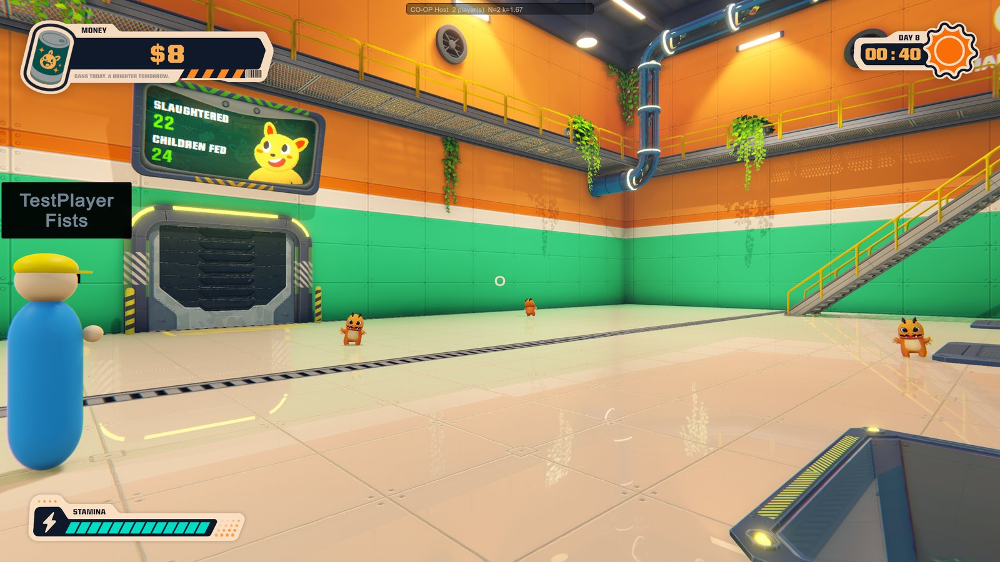
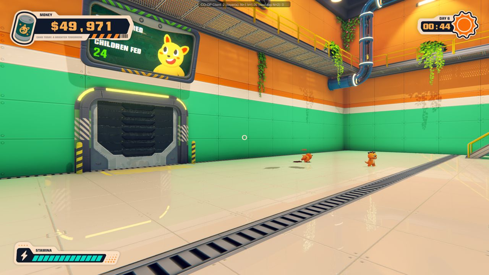

# Can 'Em All Co-op

**Online co-op multiplayer mod for [Can 'Em All](https://store.steampowered.com/app/5133900/): 2 to 4 players, one shared factory, balanced so a team progresses at the pace of a solo run.**


> **Status: pre-release (v0.1.2).** This version has been tested on **one PC with two game instances** joined over Direct TCP, which played several full days together. **The Steam connection between two different Steam accounts has not been confirmed yet**, and hand-played mechanics such as grabbing and throwing have not been through long sessions. Direct IP is the tested path; if Steam does not connect for you, please [open an issue](https://github.com/erencivril/CanEmAll-Coop/issues). Feedback is very welcome. See [Known limitations](#known-limitations) and [docs/TESTING.md](docs/TESTING.md) before you invite your friends.

| What the host sees | What the client sees |
|---|---|
|  |  |
| The other player appears as a coloured avatar with a hard hat and a name tag. | The client sees the host's enemies and the same money. The HUD line at the top shows the session (here N=1 now, N=2 from the next day, see [balancing](#how-the-balancing-works)). |

Screenshots show the game's own art, which belongs to its owners.

## Features

- **Join over Steam.** Host from the in-game F7 menu, friends join from a list of friends who are playing (and hosting). Direct IP is available as a fallback.
- **One shared world.** Money, skill tree, permanent upgrades, upgrade points and the day clock are shared. Whoever buys a skill buys it for everyone.
- **Host-authoritative.** The host runs the truck, the enemies, the grinders, the payouts and the save file. Clients cannot pay themselves, roll gameplay dice or write `save.sav`.
- **Player-count balancing.** More players means more enemies per truck and faster grinders, while each payout is divided by the same factor, so a team does not finish the game in a quarter of the time. [Details below.](#how-the-balancing-works)
- **See each other.** Remote players are drawn as avatars with name tag, weapon label, muzzle flash and shot sounds, melee swings, flamethrower and vacuum cues, and a "down" pose.
- **Shared combat and cans.** Clients shoot the host's enemies, kills and cans are counted once on the host. Grabbing, throwing and vacuuming of cans, crates and bodies has an ownership protocol so two players cannot grab the same object.
- **Team rules.** Elevators and the shop wait for a ready-up quorum (everyone, a majority, or everyone with a timeout). A death sends you back after a few seconds instead of ending the day for the whole team. If everybody is down it ends like a solo death.
- **Pause does not freeze your friends.** Opening the pause menu does not stop the world for the others.
- **Slot machine.** The host rolls it. An optional cap stops one player from gambling away the shared wallet.
- **Join mid-session.** A friend can join while the host is playing and picks up the running day.
- **Offline is vanilla.** With no session active every patch is a pass-through and every scaling factor is exactly 1.
- **No game files are modified.** The mod is a BepInEx plugin DLL.

## Requirements

- Windows and **your own copy of Can 'Em All on Steam**. Every player needs the game.
- **Every player needs the same mod version.** See [Version mismatch](#faq-and-troubleshooting).
- BepInEx 6.0.0-be.791 (IL2CPP). The "full" download already contains it.
- For Steam play: all players are Steam friends and online on Steam (see [Steam game details privacy](#faq-and-troubleshooting)).

## Quick install

1. Download `CanEmAll-Coop-<version>-full.zip` from the [Releases page](https://github.com/erencivril/CanEmAll-Coop/releases).
2. In Steam: right click **Can 'Em All** > **Manage** > **Browse local files**.
3. Extract the **whole zip into that folder** (the one with `Can 'Em All.exe`). Say yes to merging folders.
4. Start the game from Steam. **The first launch takes 1 to 3 minutes** while BepInEx generates its interop assemblies, and the game may look frozen or show a black screen. Do not close it.
5. In the main menu press **F7**. If a co-op panel opens, you are done.

Already have BepInEx 6.0.0-be.791 installed? Use `CanEmAll-Coop-<version>-plugin-only.zip` instead: it only adds `BepInEx/plugins/CanEmAllCoop/CanEmAllCoop.dll`.

Send every friend the same zip. Each release lists SHA-256 checksums.

## How to play

All co-op controls are in the panel that opens with **F7** (configurable). While you are online a small status line at the top shows role, player count, `N`, `k` and your ping.

### Host over Steam

1. Start the game, press **F7** and click **Host (Steam)**.
2. The panel shows **Your SteamID64** with a **Copy** button. Send it to a friend if they cannot find you in their list.
3. Start or continue your game as usual. Your save is the one that is used and written.
4. Friends join. The player count and `N` update, `N` is applied from the next day (see [balancing](#how-the-balancing-works)).

### Join over Steam

1. Start the game and stay in the **main menu**. Do not load a save. (A client that is already inside a solo game is sent back to the menu when it joins; its own save file is not touched.)
2. Press **F7**. The panel lists your Steam friends. Friends who are **hosting** come first and are marked `[hosting]`, then friends who are in the game but not hosting, then other online friends, offline friends last. Click **Join <name>** next to your friend.
3. If your friend is not in the list, paste their **SteamID64** (the number, or a `steamcommunity.com/profiles/...` link) into the text field below the list and click its **Join** button. The host accepts requests from anyone by default (`SteamFriendsOnly = false`); joining someone who is not on your friends list has not been tested.
4. The game loads the host's world by itself. You walk out of the elevator and join the running day, or wait for the next one.

You can also start straight into a session from the command line (Steam launch options), for example `--coop-join-steam=<SteamID64>`. The game joins as soon as Steam is ready and gives up after 3 minutes.

If the connection does not come up, the status text says why, and a message box also appears at the top of the screen for about 7 seconds. A Steam join gives up after `SteamConnectTimeoutSeconds` (25 s by default), a Direct join after 15 s.

### Direct IP (fallback, no Steam needed)

The host opens **F7** and clicks **Host (Direct, TCP 27555)**. The other players type the host's address into **Direct join** (`192.168.1.20` or `192.168.1.20:27555`) and click **Join**.

- Same LAN: nothing else is needed (allow the game through the Windows firewall when asked).
- Over the internet: either use a VPN or overlay network that gives everyone a shared address (ZeroTier, Tailscale, Hamachi and similar), or forward **TCP port 27555** on the host's router to the host's PC.
- Direct mode is plain TCP without encryption or a password. Anyone who can reach the port can join, up to 4 players. Only share your address with people you trust.
- The port is configurable (`DirectPort`).

### Command-line switches

Add them in Steam: right click the game > **Properties** > **General** > **Launch Options**.

| Switch | Effect |
|---|---|
| `--coop-host-direct[=port]` | Start hosting over Direct TCP as soon as the game is up. |
| `--coop-join-direct=ip:port` | Join a Direct host as soon as the game is up. |
| `--coop-join-steam=<SteamID64>` | Join a Steam host as soon as Steam is ready (gives up after 3 minutes). |
| `--coop-autostart` | Host: continue (or start) a game automatically. Client: join without clicking. Meant for testing. |
| `--coop-statelog=<seconds>` | Write a status line to the log every N seconds (same as `StateLogSeconds`). |

### During a session

- **Ready-up.** The shop and the elevators wait for everyone (policy `ReadyPolicy`). The on-screen hints show who is missing. You cannot un-ready.
- **Death.** You are down for `RespawnSeconds` (5 by default) and respawn at the day's spawn point. If every player is down at the same time, the day ends like a solo death.
- **Refusals and failures** (a version mismatch, a full session, a join that times out or fails, a lost connection) show as a message box at the top of the screen for about 7 seconds, on the host as well as on the client. The F7 panel keeps the same text.
- **Joining or leaving mid-day** changes `N` only from the next day.
- **If the host quits**, the clients drop to offline, keep the world locally, and **cannot save** until they restart the game.
- **Voice chat is not included.** Use Steam voice chat or Discord.

## How the balancing works

Letting several people play one factory unchanged does not give a good game. Early on, everyone shares one truck and the same few machines, so a second player would not earn faster, they would just have nothing to do. Late in the game, when your own kill rate is the limit, a team could be several times faster than a soloist. The usual fix, "multiply the prices by the player count", does not work either (see below). This mod keeps the **price list untouched** and instead changes how fast the factory runs and how much each can pays.

For `N` players the host computes `w = N^0.8` (the **workload**) and then, with `E` the number of enemies a truck delivers in a solo game at that point of the skill tree:

```
E_eff = clamp( round(E * w), E, PerfCap - 100 )       enemies per truck delivery
k     = E_eff / E                                      the realized pace factor
```

and applies it in four places:

| What | Effect | Where it matters |
|---|---|---|
| **Supply x k** | Each truck delivers `E_eff` instead of `E` enemies, and the field cap grows with `w` (up to `PerfCap`). | Early game: otherwise there is nothing for the second player to do. |
| **Grinder throughput x k** | Every grinder processes enemies `k` times faster (the process interval is divided by `k`). | Mid game: otherwise the machines are the bottleneck and the extra enemies pile up. |
| **Income / k** | Each payout is divided by `k` with an exact fractional carry, so nothing is lost to rounding. | Always: this is what restores the solo pace. |
| **N latched per day** | `N` is fixed when a day starts. Joining or leaving takes effect at the next day, or at once while you are in the shop. | Prices and ratios never change under your feet. |

Enemies per truck for a few typical solo values (`E`), with the resulting `E_eff` and, in brackets, `k`. Default settings, `PerfCap = 1000`:

| N | w = N^0.8 | E = 1 | E = 3 | E = 12 | E = 25 | E = 90 | E = 250 |
|---|---|---|---|---|---|---|---|
| 1 | 1.00 | 1 (1.00) | 3 (1.00) | 12 (1.00) | 25 (1.00) | 90 (1.00) | 250 (1.00) |
| 2 | 1.74 | 2 (2.00) | 5 (1.67) | 21 (1.75) | 44 (1.76) | 157 (1.74) | 435 (1.74) |
| 3 | 2.41 | 2 (2.00) | 7 (2.33) | 29 (2.42) | 60 (2.40) | 217 (2.41) | 602 (2.41) |
| 4 | 3.03 | 3 (3.00) | 9 (3.00) | 36 (3.00) | 76 (3.04) | 273 (3.03) | 758 (3.03) |

`k` follows the enemies that really arrive (`E_eff / E`), not the ideal `w`: with one enemy per truck you cannot deliver 1.74 enemies, you deliver 2, so the money divisor is 2. Dividing income by the real ratio keeps the pace exact whatever the rounding or the performance cap does. The full table for every "More Enemies" tier is in [docs/BALANCING.md](docs/BALANCING.md).

### Why the prices are not simply multiplied

Income per second is limited by the **smallest** of three things: how many enemies the truck delivers, how fast the grinders can eat them, and how fast the players can kill and feed them. In a solo run, the first one limits you early, the second one in the middle, and the third one late. Extra players only help with the third one: a second player does not make the truck come faster and does not make a grinder faster.

So, with prices x N:

- **Early and mid game** (truck-bound, machine-bound): income barely changes with N, prices are N times higher, so the team is **N times slower** than a soloist.
- **Late game** (kill-bound): income really does grow with N, so prices x N would be about right.

No single price factor is right in all three regimes. Instead the mod scales the supply and the machines up by `k`, so every one of the three limits grows by `k`, and then divides the income by `k`. The result is the solo pace in whichever regime you are in. Money, total money, rebirth points and every price stay in solo units, so nothing in the UI changes and `N` can change between days.

What it does *not* do, on purpose: day length, enemy health, can values, weapon damage and ammo, per-player stats and the skill prices are unchanged. [docs/BALANCING.md](docs/BALANCING.md) has the list and the reasons, and the config valves.

### Honest caveats

- A team only keeps solo pace if it can really deliver `k` times the kills. That needs each player to be at least `w/N` as effective as a soloist (87% at N=2, 76% at N=4). This is the reason the exponent is 0.8 and not 1.0.
- `0.8` and `PerfCap = 1000` are design estimates, **not yet calibrated against long real play sessions**. In a two-player test on one PC the host logged 764 money earned before the divisor and 434 paid out after it: a ratio of 0.568, which matches `1/k = 1/1.76`. So the mechanism does what it should. Whether the pace is "right" over many hours needs real play. To help with that, the host writes one `[DAYSTATS]` line per day to `BepInEx/LogOutput.log` (day, `N`, `E_base`, `E_eff`, `k`, trucks, enemies spawned, kills, can units paid, money in before the divisor and money out after it, grinder queue). Offline runs write it too, so you can compare a solo day with a co-op day.
- Skills that help every player (move speed, ammo, stamina) cost the same as in solo while skills for the factory only help once. Teams will tend to buy the personal ones first.
- HUD income numbers and floating "+$" texts are smaller than "natural", and statistic counters (kills, cans) grow by about `k`. Cosmetic only.

If you disagree with the defaults, change `WorkloadExponent` (lower is easier) or set `PaceMode = Free` (see below).

## Configuration

The config file is created on first launch with the mod: `BepInEx/config/com.eren.canemallcoop.cfg` in the game folder. Edit it with a text editor while the game is closed, or with a BepInEx config manager. The balancing settings are used by the host, because the host runs the factory.

| Section | Key | Default | Range / values | Meaning |
|---|---|---|---|---|
| Balance | `WorkloadExponent` | `0.8` | 0.3 to 1.5 | Exponent `a` in `w(N) = N^a`. 1.0 is linear and hardest to keep up with, lower is easier. |
| Balance | `PaceMode` | `Neutral` | `Neutral`, `Free` | `Neutral`: supply and grinders scale up, income is divided (team pace is about solo pace). `Free`: only the enemy supply scales, the team earns what the shared machines allow. |
| Balance | `PerfCap` | `1000` | 100 to 5000 | Upper bound for registered enemies on the host (limits the truck batch and field cap). Lower it if the host stutters. |
| Balance | `ScaleConveyor` | `false` | true / false | Also speed up the conveyor belts with the player count. Only if belts jam. |
| Balance | `ScaleFirstBloodCounters` | `false` | true / false | Scale the First Blood and Starting Shockwave per-day counters with the player count. |
| Balance | `MaxSpawnBatch` | `650` | 1 to 5000 | Largest truck delivery (enemies created in one frame) the scaling may ask for, on top of `PerfCap`. Without it a 4-player late game would create about 758 enemies in one frame and hitch. `k` follows the batch that really arrives. |
| Balance | `IncomeDivisorExponent` | `1.0` | 0 to 2 | Income is divided by `k` to this power. 1.0 keeps a team at solo pace, below 1 the team earns faster, above 1 slower, 0 switches the division off. |
| Rules | `RespawnSeconds` | `5` | 0 to 60 | Seconds until a downed player respawns while the team is alive. |
| Rules | `ReadyPolicy` | `All` | `All`, `Majority`, `AllWithTimeout` | Who must be ready before the next day or the elevator moves on. |
| Rules | `ReadyTimeoutSeconds` | `60` | 5 to 600 | For `AllWithTimeout`: seconds before the host continues without the missing players. |
| Rules | `MaxBetFraction` | `1.0` | 0.01 to 1 | Largest slot machine stake as a fraction of the shared wallet. 1.0 = no limit, 0.25 = at most a quarter of the wallet per spin. |
| Network | `MenuKey` | `F7` | any Unity `KeyCode` name | Key that opens the co-op panel (for example `F8`, `BackQuote`). |
| Network | `DirectPort` | `27555` | 1024 to 65535 | TCP port for Direct host / Direct join. |
| Network | `PeerTimeoutSeconds` | `30` | 10 to 300 | Seconds without any packet from the other side before an established session is dropped. Keep it at 30 or more so a long frame hitch does not end a session. |
| Network | `SteamConnectTimeoutSeconds` | `25` | 5 to 120 | How long a Steam join waits for the host's answer before giving up (Steam may need 10 to 20 seconds to find a route). |
| Network | `SteamFriendsOnly` | `false` | true / false | Host (Steam): only accept session requests from users on your Steam friends list. Off by default so joining by SteamID64 also works for someone you have not added. |
| Network | `PoseRateHz` | `20` | 5 to 60 | Player pose updates per second. |
| Network | `EnemyRateHz` | `12` | 2 to 30 | Enemy position updates per second sent by the host. |
| Network | `CanRateHz` | `8` | 1 to 30 | Can and crate position updates per second sent by the host. |
| Debug | `StateLogSeconds` | `0` | 0 to 3600 | Write a `[STATE]` line (role, peers, per-module state) to the log every N seconds. 0 = off. |

Changes to the balance settings apply at the next rescale (the next day start or the next skill purchase), not instantly.

## FAQ and troubleshooting

**Where are the logs?**
`BepInEx/LogOutput.log` in the game folder (BepInEx and this mod). The game's own log is `%USERPROFILE%\AppData\LocalLow\LuisDev\Can 'Em All\Player.log`. For bug reports attach the `LogOutput.log` of **both** players. Setting `StateLogSeconds = 2` adds a `[STATE]` line every 2 seconds, which helps a lot.

**The game does not start, or nothing happens after install.**
The first launch with BepInEx takes 1 to 3 minutes. Wait for it. If the main menu comes but F7 does nothing, check that `BepInEx/plugins/CanEmAllCoop/CanEmAllCoop.dll` exists and that `LogOutput.log` contains a line `Can 'Em All Co-op 0.1.2 loaded`. Make sure `winhttp.dll` is next to `Can 'Em All.exe` and that you extracted into the right folder.

**My friend does not show up in the list.**
- Both of you must be **Steam friends**, online on Steam (not "Offline" or "Invisible"), running the game **with the mod**.
- The host must have clicked **Host** first.
- Check [Steam game details privacy](#steam-game-details-privacy) below.
- Wait a few seconds, the list refreshes every couple of seconds.
- Paste their **SteamID64** into the text field below the friends list as a workaround.

<a id="steam-game-details-privacy"></a>
**Steam game details privacy.**
Steam only tells your friends what you are playing if your profile allows it. In Steam open your profile > **Edit Profile** > **Privacy Settings** and set **Game details** to **Friends Only** or **Public**. If it is **Private**, friends cannot see that you are in the game and the friends list stays empty. (The SteamID64 field works regardless.)

**Windows Firewall or router.**
Steam play uses Steam's relay network, so you do **not** need port forwarding for it. Direct mode needs inbound **TCP 27555** on the host (or the port you configured): allow the game when Windows Firewall asks, and forward the port on your router for play over the internet.

**Version mismatch.**
Both players need the **same mod version**, built for the same game version. The joining player sends the mod version in the handshake. If it differs from the host's, **the join is refused with a message**: the joiner sees `Version mismatch: host has X, you have Y - install the same mod version`, and the host sees `Refused <name>: they have mod version Y, you have X. Both must install the same version.` Both messages appear on screen for a few seconds and stay in the F7 panel. A joiner that gets no answer at all shows "The host did not answer within N s" with a hint (is the host hosting, is it the same mod version). Send everyone the same zip. After a Steam game update, wait for a matching mod release.

**Saves: what is saved, and what to back up.**
Only the **host** saves, using the game's normal `save.sav`. A client's own save file is never written while joined (and not after leaving until the game restarts), and a client's progress is not stored anywhere. **Back up your save before your first co-op session:** copy `%USERPROFILE%\AppData\LocalLow\LuisDev\Can 'Em All\save.sav` somewhere safe. Money and prices stay in solo units, so a co-op save is a normal save, but loading one without the mod has not been tested.

**Does the mod change my solo game?**
No. With no session active every patch passes through and every factor is 1. "Feels identical" has been checked by construction and with scripted runs, not with hours of hand-played solo.

**The host stutters with many enemies.**
Lower `PerfCap` (for example to 600). It limits the scaled truck batch and field cap.

**The F7 panel is open but the game still reacts to my clicks and keys.**
Known issue: the game keeps receiving input while the panel is open. Open it where it does no harm (for example in the shop).

**How do I uninstall?**
Delete `winhttp.dll`, `doorstop_config.ini`, `.doorstop_version`, `changelog.txt` and the `BepInEx` and `dotnet` folders from the game folder. Or, in Steam: right click the game > **Properties** > **Installed Files** > **Verify integrity of game files**. To remove only the mod, delete `BepInEx/plugins/CanEmAllCoop/` (and optionally `BepInEx/config/com.eren.canemallcoop.cfg`).

## Known limitations

This list is meant to be honest. Details of what was and was not tested are in [docs/TESTING.md](docs/TESTING.md); the design is in [docs/ARCHITECTURE.md](docs/ARCHITECTURE.md).

- **The Steam connection between two different accounts has not been confirmed.** On one machine the Steam host starts, the API calls work and the host advertises itself, but the exchange of messages between two different Steam accounts (and fragmentation of the join snapshot over Steam) was not verified. Direct TCP is verified in two-instance tests. If Steam does not connect, use Direct IP and please report it.
- **Hand-played mechanics are not fully verified.** The tests drove the same code paths that input ends in, but real hands on weapon feel, vacuum, grabbing and throwing bodies and cans, turrets and robots, flamethrower burn sync, the slot machine, rebirth, the ending and the permanent-upgrade panel have not been through a long session.
- **Frame hitches.** Early test builds had single multi-second hitches (up to about 6 seconds). After the fixes, a four-day two-instance run showed no frame above 36 ms on the host and 18 ms on the client during the day (apart from scene loads of 1.4 to 1.8 seconds), with up to 209 puppets. 3 to 4 players and a 750-enemy late game were not tested. A silence longer than `PeerTimeoutSeconds` (30 s by default) drops the peer.
- **There are no per-player saves.** Only the host's `save.sav` is written, and there is no per-player kill attribution.
- **Balance is not calibrated.** The exponent and the performance cap are design estimates (see [balancing](#honest-caveats)).
- **Mid-day joins** get the player count applied from the next day. A player who leaves mid-day keeps `k` until the next day.
- **Visual and audio gaps for clients:** truck honk and door sounds, robot visuals, enemy idle and scream sounds on puppets, blood trails of bleeding enemies, shockwave explosion effects, and what other players hold in their vacuum are not replicated.
- **A downed player can still shoot.** Only movement, jumping and damage are blocked while down.
- **No voice chat**, no text chat.
- **At most 4 players**, Windows only, tested with one game build (Unity 6000.2.15f1). Not tested together with other BepInEx mods.
- **Direct TCP is unencrypted and has no password.**

## Building from source

Requirements:

- the **.NET 8 SDK** (the plugin targets `net6.0`, the test project `net8.0`)
- the game installed, with **BepInEx 6.0.0-be.791 installed into it and the game started once**, so that `BepInEx/core` and the generated `BepInEx/interop` assemblies exist (the project references them; they are not in this repository)

```
# build the plugin
dotnet build mod/CanEmAllCoop -c Release

# build and copy the DLL into <game>/BepInEx/plugins/CanEmAllCoop/
dotnet build mod/CanEmAllCoop -c Release -p:Deploy=true

# game installed somewhere else than D:\SteamLibrary\steamapps\common\Can 'Em All
dotnet build mod/CanEmAllCoop -c Release -p:Deploy=true -p:GameDir="C:\Program Files (x86)\Steam\steamapps\common\Can 'Em All"
```

The DLL ends up in `mod/CanEmAllCoop/bin/Release/net6.0/CanEmAllCoop.dll`.

Tests (pure C# logic only, **no game needed**):

```
dotnet test mod/CanEmAllCoop.Tests
```

If your checkout path is very long, Windows may fail to start the test host (260 character limit). Use a short output path: `dotnet test mod/CanEmAllCoop.Tests --artifacts-path C:/cet`.

Packaging a release (needs the BepInEx zip, `BepInEx-Unity.IL2CPP-win-x64-6.0.0-be.791`, at `vendor/bepinex/bepinex.zip` or passed with `--bepinex-zip`):

```
python -I scripts/package.py --plugin-dll mod/CanEmAllCoop/bin/Release/net6.0/CanEmAllCoop.dll --bepinex-zip path/to/bepinex.zip --version 0.1.0 --out dist
```

It writes the `-full` and `-plugin-only` zips and prints their SHA-256. It only packages an allow-listed set of BepInEx files and never game files, `BepInEx/interop`, `unity-libs`, `config` or `cache`.

## Project structure

```
mod/
  CanEmAllCoop/            the plugin
    Plugin.cs              entry point, registers the modules
    CoopConfig.cs          every config key
    Core/                  roles, peers, net ids, module host, launch arguments, logging
    Net/                   protocol, framing, Steam and Direct transports
    UI/                    F7 panel and HUD (IMGUI)
    Scaling/               player-count balancing (docs/BALANCING.md)
    Economy/               shared wallet, shop, slot machine, join snapshot
    Flow/                  day loop sync, ready-up, death/respawn, join path
    Enemies/               truck and enemies on the host, puppets on clients, hits
    Cans/                  cans, crates, bodies: spawn, merge, grab/throw ownership
    Avatar/                remote player avatars and pose interpolation
    Debug/                 test driver, does nothing without its launch switches
  CanEmAllCoop.Tests/      xUnit tests for every *.Pure.cs file
tools/InteropInspect/      lists types and members of the generated interop assemblies
docs/                      BALANCING.md, ARCHITECTURE.md, TESTING.md, images/
scripts/package.py         builds the release zips
licenses/                  license texts that ship with the full zip
```

Files named `*.Pure.cs` contain pure C# (no Unity, no BepInEx, no Harmony) so they can be unit tested; the test project compiles them directly.

## How it works

The host is the authority. It runs the real game simulation: the truck, enemy behaviour, damage rolls, the grinders, the reward pipe, the payouts, the day loop and the save. Clients run their own player, UI, effects and audio, and show **puppets** for everything the host simulates: enemies, cans, crates, the truck, turrets and robots. A client's hit on an enemy becomes a request to the host, which applies it through the game's own damage code and sends the result back. Purchases work the same way: request, host validates and pays, everyone mirrors the result.

The mod is a set of modules that talk over a small message protocol (reliable and unreliable channels, fragmentation for large payloads) on top of either the Steam networking API or plain TCP. Game behaviour is changed with Harmony prefix and postfix patches that find their targets **by type and method name**, and a patch that cannot be applied disables only its own feature instead of crashing the game. [docs/ARCHITECTURE.md](docs/ARCHITECTURE.md) has the module list, message flow, the authority table and the hook list.

## Contributing

Bug reports and pull requests are welcome.

- **Bugs:** use the bug report template and attach the `BepInEx/LogOutput.log` of the host **and** the client, plus the player count and the mod version.
- **Ideas:** open a feature request. Balance feedback ("day 12 with 3 players felt faster/slower than solo because ...") is especially useful, please include the day, the player count and roughly what was unlocked.
- **Pull requests:** `dotnet build` with 0 errors and `dotnet test` green. Keep three rules: offline must stay vanilla, patch by name and fail soft, and keep `*.Pure.cs` free of Unity and BepInEx types. See [docs/ARCHITECTURE.md](docs/ARCHITECTURE.md).
- **Please do not submit game files, game code or assets taken from the game, or memory addresses.** They cannot be accepted.

## License

The mod is released under the [MIT license](LICENSE). The full release zip bundles BepInEx and related components under their own licenses (LGPL-2.1, LGPL-3.0, MIT, Apache-2.0), see [THIRD_PARTY_NOTICES.md](THIRD_PARTY_NOTICES.md) and the [licenses](licenses) folder.

## Disclaimer

This is an **unofficial fan mod**. It is **not affiliated with or endorsed by LuisDev** or the game's publisher. **You must own Can 'Em All** to use it. **No game files are redistributed**: the release only contains the mod plugin and BepInEx. Use at your own risk, and back up your save before playing.
