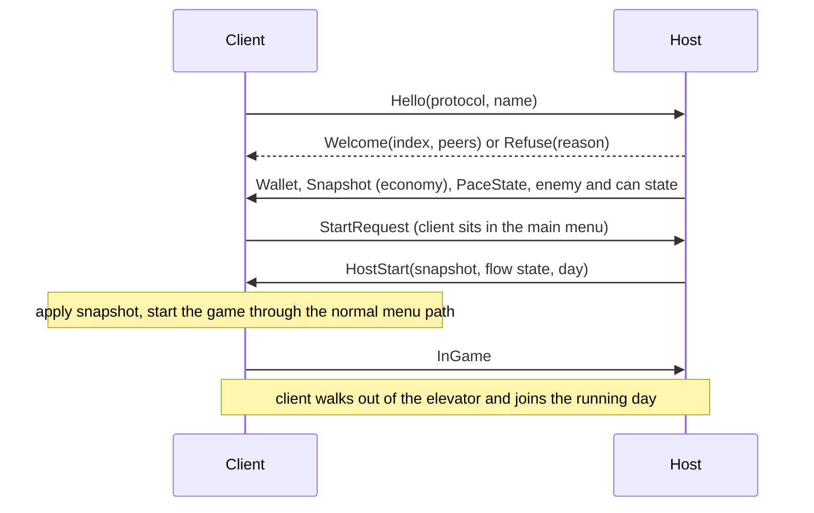
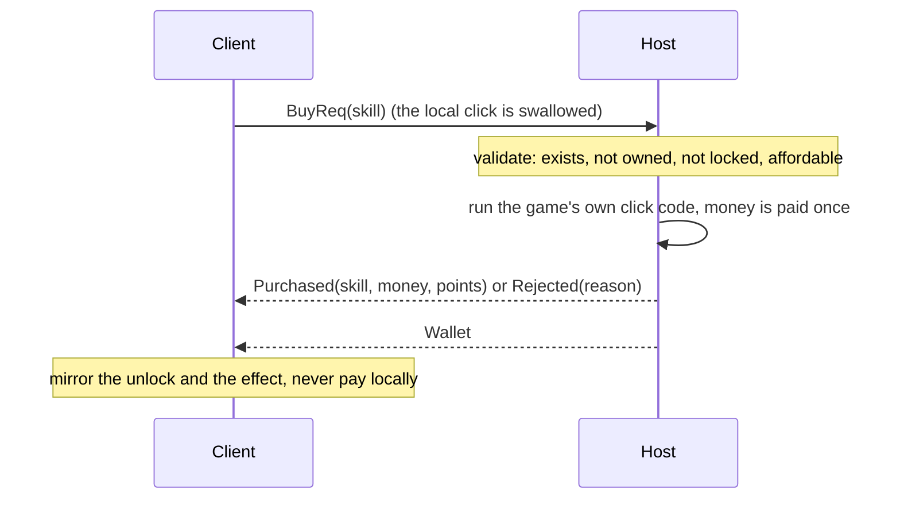
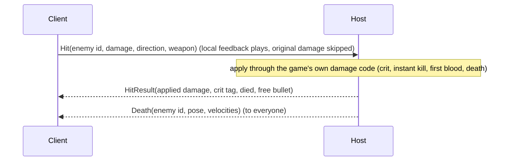

# Architecture

How the co-op mod is put together: modules, the network protocol, message flow, who is the authority for what, and the full list of Harmony hooks. For the balancing model see [BALANCING.md](BALANCING.md).

Game class names appear here only where they are needed to explain a hook. The mod resolves every hook **by type and method name**, never by address, and uses the interop assemblies that BepInEx generates on your machine. Nothing from the game is copied into this repository.

## 1. Principles

1. **Offline is vanilla.** With no session (`Net.Role == Offline`) every patch is a pass-through and every scaling factor is exactly 1.
2. **The host is the authority.** The host runs everything that rolls dice, spawns, pays or saves. Clients run their own player, UI, effects and audio, and show puppets for what the host simulates. Clients never pay, never roll gameplay randomness, never spawn trucks, never run the grinders and never write `save.sav`.
3. **Shared progression.** Wallet, unlocked skills, permanent upgrades, upgrade points, day and mails belong to the host and are replicated.
4. **Patch by name, fail soft.** Each hook is looked up by type and method name. If a target is missing, the module logs an error and disables only that feature. IL2CPP Harmony offers prefix, postfix and finalizer patches (no transpilers), so the mod works within that.
5. **No game files are modified.** The only thing installed is the plugin DLL (and BepInEx).

## 2. Modules

| Module | Folder | Responsibility | Message ids |
|---|---|---|---|
| Foundation | `Plugin.cs`, `CoopConfig.cs`, `Core/`, `Net/`, `UI/` | Roles and peers, net ids, module host, transports, protocol, F7 panel and HUD, launch arguments, config | 0 to 99 |
| Scaling | `Scaling/` | Player-count balancing: latched `N`, `E_eff`, `k`, grinder speed, payout division | 600 to 699 |
| Economy | `Economy/` | Shared wallet, skill and permanent-upgrade purchases, rebirth, slot machine, join snapshot, periodic resync | 100 to 199 |
| Flow | `Flow/` | Day loop on every peer with a slaved timer, ready-up and elevator quorums, down and respawn, team wipe, ending, pause, save guard, the join path | 200 to 299 |
| Enemies | `Enemies/` | Truck and enemies on the host, puppets on clients, hit requests, turrets, robots, flee target selection | 300 to 399 |
| Cans | `Cans/` | Grinder and reward pipe on the host, can puppets, crates, grab, drop, throw and vacuum ownership | 400 to 499 |
| Avatar | `Avatar/` | Remote player avatars, 20 Hz pose stream with interpolation, fire and melee cosmetics, down pose, name tags | 500 to 599 |
| Debug | `Debug/` | Test driver that does nothing unless its launch switches are given | none |

Every module implements one small interface (`Init`, `OnUpdate`, `OnSessionStart`, `OnSessionEnd`, `OnPeerJoined`, `OnPeerLeft`, `DebugState`). The module host calls them inside guards, so an exception in one module is logged and cannot take the game down.

Pure logic (math, codecs, interpolation buffers, quorum rules, state machines) lives in `*.Pure.cs` files that reference neither Unity nor BepInEx nor Harmony. The test project compiles those files directly, which is why the unit tests run without the game.

Shared services in `Core/`:

- `NetIds`: one id space for enemies, cans and crates, so the grab protocol can refer to any grabbable object. The host assigns, clients bind.
- `PlayerPositions`: a registry of "where are the players" (local player plus every remote avatar), used for the enemy flee target.

## 3. Transport and protocol

| | Steam (primary) | Direct (fallback and local testing) |
|---|---|---|
| Carrier | Steam Networking Messages through the game's already initialised Steam API, relayed by Steam | TCP, length-prefixed frames, default port 27555 |
| Addressing | SteamID64 | host:port |
| Unreliable messages | Unreliable send flag | Sent over the same TCP stream |
| Session setup | Steam drops messages from unknown users until the session is accepted, so the host accepts sessions about once a second for friends who are in the game and for every known peer | Host accepts connections on all interfaces |

Wire format: every message starts with a 16-bit header: low 13 bits are the message id, `0x2000` marks unreliable, `0x4000` directed, `0x8000` relayed by the host. A client can only talk to the host; the host re-broadcasts when other clients need to see something (for example poses). Large payloads, such as the join snapshot, are fragmented and reassembled by the protocol layer.

Core messages (ids 0 to 7): `Hello`, `Welcome`, `PeerList`, `Bye`, `Ping`, `Pong`, `Fragment`, `Refuse`. The handshake carries a protocol version and the mod version string; the host refuses a different protocol, a different mod version and a full session (maximum 4 players), and both sides show the reason on screen. A peer that sends nothing for `PeerTimeoutSeconds` (30 by default) is dropped; a join that gets no answer gives up after 25 s (Steam, `SteamConnectTimeoutSeconds`) or 15 s (Direct).

Messages are handled on the Unity main thread; the transport is pumped from an injected behaviour.

## 4. Message flow

### Joining

### A purchase

### A hit on an enemy

### The day loop

Every peer runs the real game loop (UI, fades, elevator, teleports). The host decides when it moves on:

- the day and night timer of a client is slaved to the host (timer message at 2 Hz, flow state on every change),
- elevator triggers are swallowed, reported to the host, and the original code runs when the host answers "go" (a quorum barrier),
- the shop wait is held until the ready quorum (`ReadyPolicy`) is met,
- at the start of every day the host latches `N` and sends the economy resync.

### Continuous streams

| Stream | From | Rate | Reliability |
|---|---|---|---|
| Player pose | every peer, relayed by the host | `PoseRateHz` (20) | unreliable |
| Enemy transforms | host | `EnemyRateHz` (12), only entities that moved, keyframe every few seconds | unreliable |
| Can and crate transforms | host (or the holder while held) | `CanRateHz` (8), only entities that moved | unreliable |
| Truck, doors, turrets, robots | host | about 10 Hz, only when changed | unreliable |
| Day timer | host | 2 Hz | unreliable |
| Wallet | host | on change, at most every 100 ms | reliable |
| Economy resync | host | every 15 s | reliable |

Spawns, deaths, returns, merges, payouts, ownership changes, purchases and flow transitions are all reliable events.

## 5. Who is the authority

| Thing | Host | Client |
|---|---|---|
| Truck, enemy spawns, enemy behaviour and pathing, bleeding | simulates | shows puppets (physics and behaviour scripts off) |
| Damage, crits, kills, first-blood and shockwave perks | rolls and applies | sends `Hit`, plays local feedback, no gameplay dice |
| Grinder processing, can creation and merging, reward pipe, payouts | runs | puppets and effects only |
| Wallet, skills, permanent upgrades, upgrade points, rebirth | owns, validates and pays | sends requests, mirrors results |
| Slot machine | rolls | replays the host's result with the game's own animation |
| Day clock and phase | owns | slaved |
| Ready-up and elevator quorum, ending | counts and releases | reports and waits |
| Death and respawn | tracks who is down, decides a team wipe | local player is down for `RespawnSeconds`, then respawns |
| `N`, `k`, enemy batch size, grinder speed | computes and applies | mirrors the numbers for the UI only |
| Save file | writes at day end | never writes (also not after leaving, until restart) |
| Pause | none: the world keeps running | local pause menu without freezing time |
| Own player movement, camera, weapons, ammo, UI | own | own |
| Grabbed cans, crates and bodies | decides who holds what | optimistic local grab, host confirms or rolls back, the holder streams the object |
| Avatar pose | its own player | its own player, relayed by the host |

## 6. Harmony hooks

Legend: pre = prefix, post = postfix, fin = finalizer. "H" is host (and offline) behaviour, "C" is client behaviour. Offline every hook is a pass-through. Methods are listed as `Class.Method`.

### Scaling

| Hook | Kind | H | C |
|---|---|---|---|
| `MoreCreaturesSkill.ApplySkill` | post | remember `E`, rescale the truck | remember `E` only |
| `Truck.ResetToDefaultValues` | post | same | same |
| `Truck.Awake` | post | remember the original field cap, rescale | same |
| `CanProcessor.GetCanInterval` | post | divide by `k` (Neutral only) | pass |
| `MoneyManager.AddMoney` | pre | divide the payout by `k` with exact carry | block unless the host's state is being applied |
| `MoreCreaturesSkill.GetFromValueText` | pre + fin | show the solo `E` while scaled | pass |
| `GameManager.UpdateConveyorSpeed` | pre + fin | optional conveyor scaling | pass |
| `GameManager.OnHitEnemy`, `GameManager.OnEnemyDeath` | pre + post | optional first-blood and shockwave counter carry | no-op |

If a required scaling hook fails to apply, scaling is disabled completely: it is never half applied.

### Economy

| Hook | Kind | H | C |
|---|---|---|---|
| `MoneyManager.AddMoney` | pre (last) | pass | block |
| `MoneyManager.ChangeMoney` | pre (last) + post | post flushes the wallet | block unless applying host state |
| `MoneyManager.SetMoney` | pre (last) | pass | block unless applying host state |
| `SkillNode.OnClick` | pre + post | run, post broadcasts `Purchased` | a click that would pay becomes `BuyReq` |
| `PermanentUpgrade.OnClick` | pre + post | run, post broadcasts | becomes `PermReq` |
| `PermanentUpgradeManager.Sell` (rebirth) | pre + post | run once, broadcast the new snapshot | becomes `SellReq` |
| `SkillPopUp.Show` (both overloads) | pre | suppressed while the host runs a friend's click | pass |
| `SlotMachine.Spin` | pre + post | clamp the stake to `MaxBetFraction`, announce the result | click becomes `SpinReq`, replay of the host result runs the real spin |
| `SlotMachine.GenerateResult` | pre + post | post captures the reels | pre returns the host's reels during a replay |

### Flow

| Hook | Kind | H | C |
|---|---|---|---|
| `GameManager` game-loop coroutine `MoveNext` | pre + post | latch `N` at day start, broadcast the economy resync, hold the shop wait until the ready quorum | hold the shop wait until the host says go |
| `GameManager` suicide coroutine `MoveNext` | pre + post | hold the shop wait after a team wipe | same |
| `GameManager.OnTriggerOutsideElevator` | pre | quorum barrier | report, swallow |
| `GameManager.OnTriggerInsideElevator` | pre | quorum barrier | report, swallow |
| `ExitDoor.OnTriggerInsideElevator` | pre | ending barrier | report, swallow |
| `GameManager.Suicide` | pre | cancelled: the player is "down" for `RespawnSeconds`; original only on team wipe | same |
| `GameManager.UpdatePause` | post | keep time and audio running | same |
| `SaveManager.Save` | pre | allowed (unless this process applied host data) | blocked |

The two coroutine hooks are found by name at runtime (compiler-generated iterator types).

### Enemies

Eager hooks are installed at start-up; lazy ones the first time the process becomes a client, so offline play never touches the high-frequency ones.

| Hook | Kind | H | C |
|---|---|---|---|
| `Truck.StartTruck` | pre (eager) | run | skip |
| `Truck.SpawnEnemiesInsideTruck` | pre + post (eager) | post assigns net ids and broadcasts `Spawn` | skip |
| `Truck.ReturnEnemy` | post (eager) | release id, queue `Return` | drop the puppet |
| `Truck.ReturnAllActiveEnemies`, `Truck.StopTruck`, `GameManager.CleanAllScene` | pre + fin (eager) | bulk scope, then `CleanAll` with the ids that remain | local clean-up |
| `Enemy.ReleaseFromTruck` | post (eager) | queue `Release` | none |
| `Enemy.ApplyDamagedDelivery` | post (eager) | queue `Damaged` | none |
| `GameManager.OnHitEnemy` | post (eager), pre (lazy) | capture the applied damage for `HitResult` | return 0, skip |
| `GameManager.OnEnemyDeath` | post (eager), pre (lazy) | broadcast `Death` | skip |
| `Enemy.TryPickFleePath` | pre + fin (eager) | flee from the nearest of all player positions | none |
| `Turret.Shoot` | post (eager), pre (lazy) | broadcast `TurretShot` | skip |
| `Enemy.Damage` | pre (lazy) | pass | puppet: queue `Hit`, local feedback, skip |
| `Enemy.AddBurn` | pre (lazy) | pass | queue `Burn`, original still runs |
| `Enemy.BleedDamage`, `Enemy.UpdateBleeding` | pre (lazy) | pass | skip |
| `Enemy.Update`, `FixedUpdate`, `FollowPath`, `UpdatePanic`, `StartPanic` | pre (lazy) | pass | skip for puppets |
| `Turret.Update` | pre (lazy) | pass | only the power state update |
| `RobotCleaner.Update`, `RobotCleaner.FixedUpdate` | pre (lazy) | pass | skip |

If a critical enemy hook cannot be applied, the module turns itself off; a client whose critical client-side hook failed leaves the session instead of running a second truck.

### Cans

| Hook | Kind | H | C |
|---|---|---|---|
| `CanProcessor` enemy-processing coroutine `MoveNext` | pre | run | end the coroutine: the grinder never runs |
| `CanProcessor.SpawnCan` | pre + post | post announces `Spawn` | skip |
| `CanProcessor.CreateOrAccumulateCan` | pre + post | brackets merge detection | skip |
| `CanProcessor.FindCompatibleCan` | post | capture the result | none |
| `GameManager.GetCanFromPool` | post | capture the can | none |
| `RewardMachine.ProcessEnemies` | pre | run | skip |
| `RewardMachine.ReturnCanAfterDelay` | pre | broadcast `Paid` | none |
| `Player.GrabDeadBody` | pre | refuse if someone else holds it | same |
| `Player.ThrowHeldBody` | pre + post | record thrown id and velocity | same |
| `Vacuum.Suck` | pre | none | give nearby puppets physics for a short moment |

### Avatar

| Hook | Kind | Behaviour |
|---|---|---|
| `Player.RecoilCamera` | post | increments the fire counter that drives the remote muzzle flash (only when online) |

### Methods patched by more than one module

| Method | Modules | How they coexist |
|---|---|---|
| `MoneyManager.AddMoney` | scaling (pre), economy (pre, last) | Scaling runs first and divides on the host; economy runs last and blocks on clients. The roles never overlap. A skipped original still triggers the wallet broadcast, which polls the value. |
| `GameManager.OnHitEnemy`, `OnEnemyDeath` | scaling (optional counters), enemies | Disjoint roles: on a client enemies skips the original, so scaling sees unchanged counters. |
| `Truck.ResetToDefaultValues` | scaling (post), economy (calls it during the snapshot reset) | The postfix only reads and rescales. |

No two modules patch the same method with prefixes that both return false. The only explicit patch priority is economy's "last" on the three money methods.

## 7. Message ids

| Range | Module | Messages |
|---|---|---|
| 0 to 7 | Foundation | Hello, Welcome, PeerList, Bye, Ping, Pong, Fragment, Refuse |
| 100 to 199 | Economy | Wallet, BuyReq, Purchased, Rejected, PermReq, PermPurchased, SellReq, Sold, SpinReq, SpinGo, Snapshot, SnapReq, Sync |
| 200 to 299 | Flow | StartRequest, HostStart, InGame, Timer, FlowState, BarrierReport, BarrierGo, BarrierStatus, PlayerDown, PlayerUp, TeamWipe, DownList |
| 300 to 399 | Enemies | Spawn, Transforms, Death, Return, CleanAll, Hit, HitResult, Damaged, Release, World, TurretShot, Burn |
| 400 to 499 | Cans | Spawn, Merge, Paid, Gone, Transforms, CrateIds, GrabReq, GrabResult, OwnerSet, HeldXform, Release |
| 500 to 599 | Avatar | Pose |
| 600 to 699 | Scaling | PaceState |

Ids below 100 are reserved for the foundation; registering one from a module throws.

## 8. Failure behaviour

- A module that cannot apply a required hook disables itself and logs `Error`; the rest keeps working.
- A hook body that throws falls back to the original method.
- Losing the host ends the session: clients drop to offline, keep their local world and cannot save until restart.
- Losing a client mid-day releases what it held, drops it from every quorum and, from the next day, lowers `N`.
- A client's save is protected twice: `SaveManager.Save` is blocked while online and in any process that applied host data until the game restarts.

## 9. Changing or adding a hook

1. Resolve the target by type and method name and check that it exists in the generated interop assemblies. `tools/InteropInspect` prints types and members for that.
2. Make the first line of the prefix a pass-through for `Net.Role == Offline`.
3. Decide host and client behaviour explicitly and add a row to the table above.
4. Keep pure logic in a `*.Pure.cs` file with a test.
5. Never copy game code, addresses or assets into the repository.
